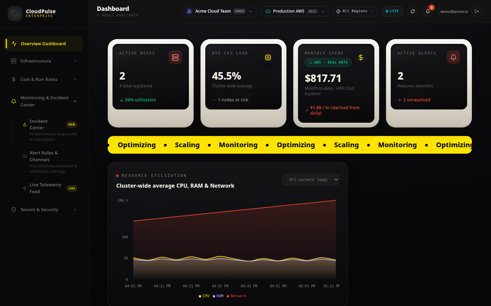
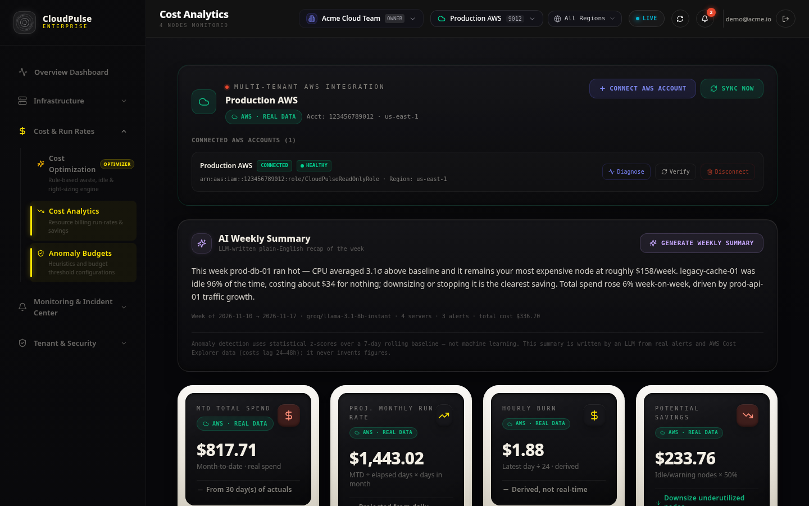
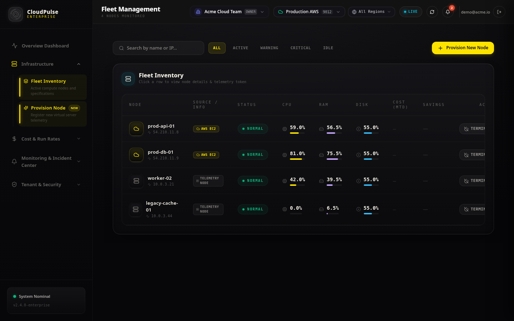
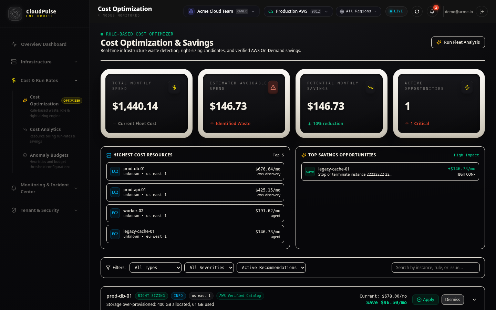
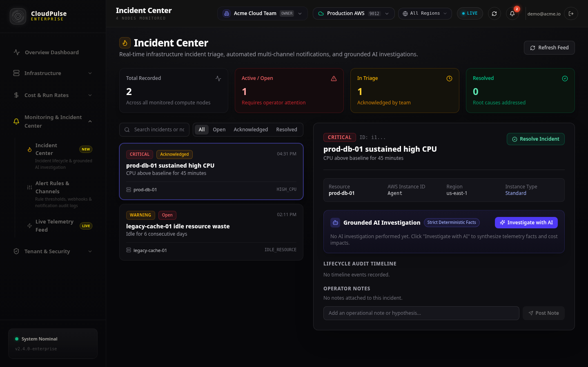

# CloudPulse AI ☁️⚡

**Know what your cloud is doing — and what it's costing you.**

CloudPulse AI is a monitoring dashboard for cloud infrastructure. It watches
your servers in real time, pulls your *real* AWS bill, flags waste and
anomalies, and turns incidents into a workflow — all scoped per workspace,
so a team only ever sees its own infrastructure.

No fabricated numbers, ever: costs are either real AWS Cost Explorer data or
an honest `$0` with a "connect your account" prompt.

---

## 📸 Screenshots

*Captured from a local run with sample fleet data — the UI, layout and
computed numbers are the real app's.*

**Overview dashboard** — fleet KPIs, live utilization chart, active alerts



**Cost Analytics** — connected AWS account, AI weekly summary, run rates



**Fleet Inventory** — every node with source, status and live metrics



**Cost Optimization** — waste findings with estimated monthly savings



**Incident Center** — incidents with severity, status and AI investigation



---

## ✨ What you get

| Area | What's inside |
|---|---|
| **Live fleet monitoring** | CPU / RAM / network / disk telemetry every few seconds, KPI cards, per-server charts, 5-second auto-refresh |
| **Real AWS costs** | Daily spend from AWS Cost Explorer, month-to-date + projected run rate, breakdowns by account, service, region and server |
| **Cost optimization** | Rightsizing and idle-resource recommendations with estimated monthly savings |
| **Anomaly detection** | Per-server rolling 7-day baselines with z-score detection — statistics, honestly labelled, not "ML magic" |
| **Alerts & incidents** | Configurable alert rules, webhook/email notification channels, incident lifecycle with notes, timeline and AI-assisted investigation |
| **Weekly AI summary** | A plain-English recap of the week's usage, spend and alerts (free-tier Groq or Gemini) |
| **Multi-tenant workspaces** | Organizations with OWNER / ADMIN / MEMBER / VIEWER roles, member invites, audit log and usage metering |
| **AWS auto-discovery** | Connect an AWS account once (cross-account IAM role) and EC2 / RDS / Lambda resources appear automatically |

---

## 🏗️ How it works

```
┌──────────────────┐  POST /api/metrics          ┌──────────────┐
│ Telemetry Agent  │  Bearer <ingestion_token>   │   FastAPI    │
│ (psutil, on your │ ───────────────────────────▶│   Backend    │
│  servers)        │                             └──────┬───────┘
└──────────────────┘                                    │ service key
┌──────────────────┐  GET /api/*                        ▼
│  Next.js         │  Bearer <Supabase JWT>      ┌──────────────┐
│  Dashboard       │ ───────────────────────────▶│  Supabase    │
│                  │                             │  Postgres    │
└──────────────────┘                             └──────────────┘
        ▲
        │  AWS Cost Explorer + resource discovery (STS AssumeRole)
┌──────────────────┐
│   Your AWS       │
│   account(s)     │
└──────────────────┘
```

Two separate security planes, by design:

1. **Dashboard plane** — every `/api/*` call carries your Supabase login
   token. The backend verifies the JWT and scopes *all* data to your
   workspace. No token → `401`. Another workspace's data → invisible.
2. **Telemetry plane** — servers push metrics with their own per-node
   ingestion token. A leaked node token can only write that node's
   metrics; it can never read dashboard data.

---

## 🚀 Quick start

You need: a free [Supabase](https://supabase.com) project, Python 3.11+,
and Node 20+.

### 1. Database (Supabase)

1. Create a project at [supabase.com](https://supabase.com).
2. **Authentication → Providers → Email**: enable the Email provider
   (this powers password and magic-link sign-in).
3. **SQL Editor**: paste and run [`supabase-schema.sql`](supabase-schema.sql).
   That single file creates every table, function and security policy.
   *(The `migrations/` folder holds the same changes as incremental steps,
   only needed if you set up an early version of the schema.)*
4. From **Settings → API**, note three values — you'll need them below:
   - Project URL
   - `anon` public key
   - `service_role` secret key
5. From **Settings → API → JWT Settings**, also note the **JWT Secret**.
   The backend cannot verify logins without it.

### 2. Backend

```bash
cd backend
python -m venv .venv && source .venv/bin/activate
pip install -r requirements.txt
cp .env.example .env    # fill in SUPABASE_URL, SUPABASE_SERVICE_KEY, SUPABASE_JWT_SECRET
uvicorn main:app --reload --port 8000
```

Check it: [http://localhost:8000/health](http://localhost:8000/health)
should return `{"status":"ok","database":"connected"}`.

### 3. Frontend

```bash
cd frontend
cp .env.local.example .env.local   # Supabase URL, anon key, NEXT_PUBLIC_API_URL=http://localhost:8000
npm install
npm run dev
```

Open [http://localhost:3000](http://localhost:3000), create an account, and
you're in. A default workspace is created for you automatically.

### 4. Monitor a server (telemetry agent)

In the dashboard go to **Fleet Inventory → Provision Node**. You'll get a
node with its own ingestion token. On that server run:

```bash
pip install psutil httpx
python backend/telemetry_agent.py --token <INGESTION_TOKEN> --url http://localhost:8000 --interval 5
```

The agent reports real host metrics only (CPU, RAM, network, disk, uptime).
Unknown tokens are rejected with `401` — servers are never auto-registered.

### 5. Connect AWS (optional, for real costs)

In the dashboard, open the **AWS connection wizard** and follow it:

1. CloudPulse generates a one-time **External ID** and a ready-made
   CloudFormation link.
2. Launch the stack in your AWS account — it creates a **read-only IAM
   role** that CloudPulse can assume (STS AssumeRole, no access keys
   stored).
3. Paste the role ARN back, hit **Verify**, then **Sync**.

From then on CloudPulse discovers your EC2/RDS/Lambda resources and pulls
daily costs automatically. Until an account is connected, the dashboard
runs in **simulated mode**: costs show `$0` with a connect prompt — never
an invented estimate.

> **Cost Explorer timing:** AWS cost data is daily and lags 24–48 hours.
> "Hourly burn" in the UI is derived from the latest full day and labelled
> as such.

<details>
<summary>Alternative: single-account mode via environment variables</summary>

For a quick single-account setup you can skip the wizard and put read-only
credentials in `backend/.env` instead:

```bash
AWS_ACCESS_KEY_ID=AKIA...
AWS_SECRET_ACCESS_KEY=...
AWS_REGION=us-east-1
AWS_COST_TAG_KEY=server
```

The IAM policy only needs `ce:GetCostAndUsage`. Tag cost-bearing resources
with the key `server` and a value matching the node's cost tag so spend is
attributed per node.
</details>

---

## 🔍 The honest parts (read this)

**Anomaly detection is statistics, not ML.** Each server gets a rolling
7-day baseline (mean + standard deviation per metric). A new sample is
flagged when its z-score crosses a threshold (CPU `3.0`, network `4.0` —
network is burstier). Idle detection uses an absolute floor instead,
because a chronically idle server has a flat baseline z-scores can't see.
A server needs at least 10 samples before any claim is made.

**The AI summary only summarizes.** The weekly job hands a free-tier LLM
(Groq `llama-3.1-8b-instant` or Gemini `gemini-2.5-flash`) real numbers
from telemetry, Cost Explorer and alerts, and its prompt forbids inventing
values. Without an API key it reports "LLM not configured" — it never
fabricates a summary. Trigger it on demand with
`POST /api/insights/generate`.

---

## 🔌 API reference

All dashboard endpoints require `Authorization: Bearer <Supabase JWT>`.
The only public routes are `GET /health` and `POST /api/metrics`
(per-node ingestion token).

| Group | Endpoints |
|---|---|
| **Health** | `GET /health` |
| **Telemetry** | `POST /api/metrics` · `GET /api/servers/{id}/metrics` · `POST /api/servers/sync-node` |
| **Fleet** | `GET /api/servers/status` · `PUT /api/servers/{id}/status` · `DELETE /api/servers/{id}` |
| **Cloud (legacy sync)** | `GET /api/cloud/status` · `POST /api/cloud/discover` · `POST /api/cloud/sync` |
| **AWS connections** | `POST /api/aws/connections/initiate` · `GET/POST /api/aws/connections` · `GET/DELETE /api/aws/connections/{id}` · `POST …/{id}/verify` · `GET …/{id}/health` · `POST …/{id}/sync` |
| **Workspaces & RBAC** | `GET/POST /api/organizations` · `GET/PUT/DELETE /api/organizations/{id}` · `GET/POST /api/organizations/{id}/members` · `PUT/DELETE /api/organizations/{id}/members/{member_id}` · `GET /api/organizations/{id}/audit-logs` · `GET /api/organizations/{id}/usage` |
| **Costs** | `GET /api/costs/account` · `GET /api/costs/services` · `GET /api/costs/regions` · `GET /api/costs/trends/{server_id}` · `GET /api/costs/anomalies/{server_id}` |
| **Alerts** | `GET /api/alerts` · `PATCH /api/alerts/{id}/resolve` |
| **Alert rules & channels** | `GET/POST /api/alerts/rules` · `DELETE /api/alerts/rules/{id}` · `GET/POST /api/alerts/channels` · `DELETE /api/alerts/channels/{id}` · `POST /api/alerts/channels/{id}/test` · `GET /api/alerts/logs` |
| **Anomalies** | `GET /api/anomalies` · `GET /api/anomalies/events` · `PATCH /api/anomalies/{id}/resolve` · `GET /api/anomalies/baseline/{server_id}` |
| **Optimization** | `GET /api/optimization/summary` · `GET /api/optimization/recommendations` · `POST /api/optimization/analyze` · `PATCH /api/optimization/recommendations/{id}/status` |
| **Incidents** | `GET /api/incidents` · `GET /api/incidents/{id}` · `PATCH /api/incidents/{id}/status` · `POST /api/incidents/{id}/notes` · `POST /api/incidents/{id}/investigate` |
| **Insights** | `GET /api/insights/latest` · `POST /api/insights/generate` |

Interactive docs: [http://localhost:8000/docs](http://localhost:8000/docs)
while the backend is running.

---

## ⚙️ Configuration

### Backend (`backend/.env` — see [`.env.example`](backend/.env.example))

| Variable | Required | What it does |
|---|---|---|
| `SUPABASE_URL` | ✅ | Your Supabase project URL |
| `SUPABASE_SERVICE_KEY` | ✅ | Service-role key (backend only — never ship to the frontend) |
| `SUPABASE_JWT_SECRET` | ✅ | Verifies dashboard logins; without it every dashboard call returns 401 |
| `CORS_ORIGINS` | | Comma-separated frontend origins (default `http://localhost:3000`) |
| `RATE_LIMIT_PER_MINUTE` | | Ingestion rate limit per IP (default `30`) |
| `GROQ_API_KEY` / `GEMINI_API_KEY` | | Weekly AI summary (pick one, both free-tier) |
| `AI_PROVIDER` | | `groq`, `gemini`, or `auto` (default) |
| `AWS_ACCESS_KEY_ID` / `AWS_SECRET_ACCESS_KEY` | | Only for the legacy single-account cost mode |
| `ANOMALY_Z_SCORE`, `NETWORK_Z_SCORE`, `BASELINE_DAYS`, … | | Detection tuning — defaults are sensible, see `.env.example` |
| `SMTP_HOST`, `SMTP_USER`, `SMTP_PASS`, … | | Email notification channel |

### Frontend (`frontend/.env.local`)

| Variable | What it does |
|---|---|
| `NEXT_PUBLIC_SUPABASE_URL` | Same Supabase project URL |
| `NEXT_PUBLIC_SUPABASE_ANON_KEY` | Anon public key (safe in the browser; data is protected by RLS + backend auth) |
| `NEXT_PUBLIC_API_URL` | Backend URL the browser calls (inlined at build time — set it before deploying) |

---

## ☁️ Deployment

**Docker (local full stack)**

```bash
# create backend/.env and frontend/.env.local first
docker compose up --build
# backend → http://localhost:8000 · frontend → http://localhost:3000
```

**Backend → Render (free tier)**
Use the shipped [`render.yaml`](render.yaml) Blueprint
(**New → Blueprint → pick this repo**). Set `SUPABASE_URL`,
`SUPABASE_SERVICE_KEY`, `SUPABASE_JWT_SECRET` and `CORS_ORIGINS`
(your Vercel origin) in the Render dashboard. Note: free services sleep
after ~15 min idle; `/health` doubles as the wake-up check.

**Frontend → Vercel**
Import the repo and set the project **Root Directory to `frontend`**
(`frontend/vercel.json` is included). Set the three `NEXT_PUBLIC_*`
variables for Production — `NEXT_PUBLIC_API_URL` must be your Render URL,
and it is baked in at build time, so set it *before* deploying.

**Database → Supabase (free tier)** — already done in step 1 of Quick start.

---

## 🧪 Testing & CI

```bash
cd backend && pip install -r requirements-dev.txt && python -m pytest
cd frontend && npm run build && npm run test:e2e
```

- **183 backend tests**, no setup needed — the suite runs fully offline
  with dummy credentials (`backend/tests/conftest.py`). It includes an
  API smoke test (`test_api_smoke.py`) that drives **every route**
  end-to-end and fails on any 500.
- **Frontend**: production build + a Playwright smoke test.
- **GitHub Actions** (`.github/workflows/ci.yml`) runs both on every
  push/PR to `main`.

---

## 📁 Project structure

```
CloudPulse-AI/
├── backend/               FastAPI app
│   ├── main.py            API routes (60 endpoints)
│   ├── auth.py            JWT verification + workspace RBAC
│   ├── database.py        Supabase data layer (tenant-scoped helpers)
│   ├── anomaly.py         Rolling-baseline anomaly detection
│   ├── aws_*.py           Cost Explorer, STS credentials, discovery, sync
│   ├── cost_optimizer.py  Rightsizing / waste recommendations
│   ├── insights.py        Weekly AI summary job
│   ├── telemetry_agent.py The agent you run on monitored servers
│   └── tests/             Pytest suite (incl. full-route smoke tests)
├── frontend/              Next.js dashboard
│   └── src/
│       ├── app/           Pages: fleet, costs, optimization, incidents, alerts, settings
│       ├── components/    Sidebar, charts, AWS wizard, workspace switcher…
│       └── lib/           Authenticated API client, types, contexts
├── docs/screenshots/      Demo screenshots used in this README
├── supabase-schema.sql    Complete database schema (run once in Supabase)
├── migrations/            The same schema as incremental steps (existing installs)
├── docker-compose.yml     Local full-stack dev
└── render.yaml            Render Blueprint for the backend
```

---

## 🛠️ Troubleshooting

| Symptom | Likely cause |
|---|---|
| Every dashboard page 401s / empty | `SUPABASE_JWT_SECRET` missing or wrong in `backend/.env` — the backend fails closed by design |
| Costs all show `$0` | No AWS account connected yet (simulated mode), or Cost Explorer's 24–48h lag — connect an account and Sync |
| Agent gets `401` | Wrong ingestion token — copy it again from the node's details in Fleet Inventory |
| Backend won't start | Supabase unreachable or schema not applied — re-run `supabase-schema.sql` and check `SUPABASE_URL` / `SUPABASE_SERVICE_KEY` |
| Frontend points at the wrong backend | `NEXT_PUBLIC_API_URL` is baked in at build time — fix it and rebuild/redeploy |

---

Built with FastAPI, Next.js, Supabase and AWS — designed to tell you the
truth about your infrastructure, including when the truth is "no data yet".

---

## 📄 License

[MIT](LICENSE) © 2026 Nithinkrishna T D — free to use, copy, modify and
distribute, with the copyright notice included.
